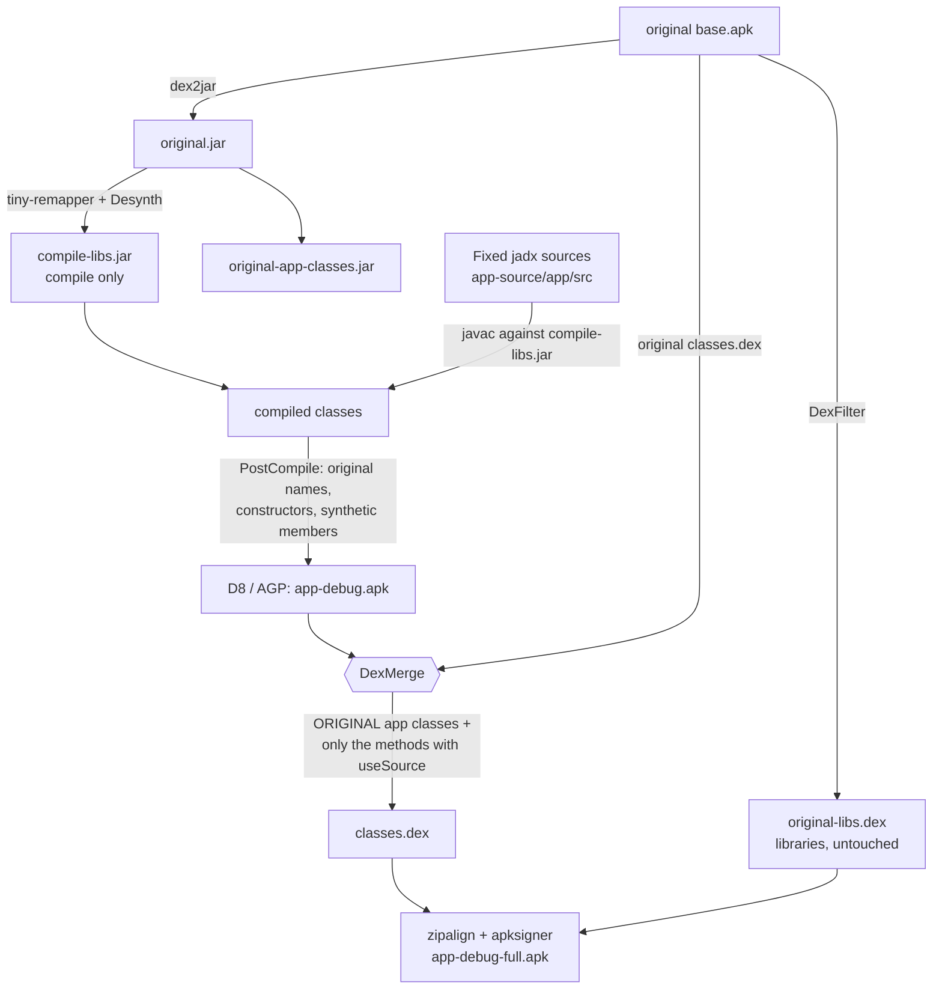

# iOS Launcher: recompiled from decompiled code

A **recompilable** copy of an iOS-style Android launcher (`com.luutinhit.launcherios`, v8.9.2), made for personal use:
it starts from the Play Store APK, decompiles it, fixes the code until it compiles and repackages it with my own changes
(language, iOS 27 icons in light and dark, no rating prompt, no ads).

<p align="center">
  
  <br><em>First page and dock in light (left) and dark (right) mode. The icons switch on their own with the system theme.</em>
</p>

> **Notice.** This repo contains decompiled code from a third-party app. It has no relationship with its author or with
> Apple. It does not include the APK or the original's API keys; those pieces come from your own copy of the app (see
> [Legal notice](#legal-notice)).

## Contents

1. [What changes from the original](#what-changes-from-the-original)
2. [How it works](#how-it-works)
3. [Repo layout](#repo-layout)
4. [Requirements](#requirements)
5. [Build](#build)
6. [Install and use](#install-and-use)
7. [Changing the app's behavior](#changing-the-apps-behavior)
8. [Light and dark icons](#light-and-dark-icons)
9. [Tools](#tools)
10. [Debugging on the phone](#debugging-on-the-phone)
11. [Status and known issues](#status-and-known-issues)
12. [Documents](#documents)
13. [Legal notice](#legal-notice)

## What changes from the original

| Change | Detail |
|---|---|
| Recompiled from code | The Java code comes from jadx, fixed by hand and with scripts until it compiles. |
| The original code runs | The final APK does not use the decompiled code except in the methods that were changed on purpose (see [How it works](#how-it-works)). |
| Spanish | The strings from `split_config.es.apk` were imported (`values-es`, `values-es-rUS`, `values-b+es+419`). |
| iOS 27 icons in light and dark | 56 icons with a light (`drawable/`) and a dark (`drawable-night/`) version: 25 from Apple (official Figma kit), 16 from apps installed on the phone and 15 derived from the original. |
| Automatic theme switching | `ThemeIconReloader` clears the icon cache and reloads the screen when the system goes from light to dark, also if the change happened while the launcher was closed. |
| No rating prompt | `IOSLauncher.startRatingActivity()` is empty: the "5 stars" request no longer appears on its own. The rate buttons in the settings still work. |
| No Play Store links | In the settings, the "5-star rating / Download other apps" card and the card for the developer's other apps (Lock Screen, Control Center, AssistiveTouch) are hidden; on the app's main screen, share (which shares a Play Store link), rate and the floating star button; and in search, "Search in the store". In the manifest, `RatingActivity` is disabled and the Play distribution markers are removed. Resources only (`tools/scripts/remove_play_store_links.py`). The Play Store app shortcut on the home screen was left alone. |
| No ads | The Google Mobile Ads (AdMob) calls on the settings and weather screens are emptied (`SettingsView.m8335E`, `WeatherActivity.m8369T`), and the ad permissions (`AD_ID`, `ACCESS_ADSERVICES_*`), meta-data, activities, service, provider and ad unit IDs are removed from the manifest and strings. The SDK files remain inside `original-libs.dex`, unused. |
| Settings without header | On the app's settings screen, the "LAUNCHER IOS" image at the top and the mail button are removed (`tools/scripts/hide_settings_header.py`). The image is not hidden with `gone`; it stays invisible, 1dp tall and without a picture: the scroll bounce divides by its height and with height 0 the app crashed on scroll. |
| No side menu | The menu that slid in from the left of the settings and its button are removed; the list starts at the top. "Privacy policy", "How to use" and "About" were web pages of the developer and now live in the repository, rewritten, in [`docs/`](docs/); "Website" is dropped with no replacement; "Reload launcher" is now the last row of the settings list. The `DrawerLayout` and the `NavigationView` stay in the layout (the original code looks for them) but hidden and locked (`tools/scripts/remove_drawer_menu.py`). |
| First load without "Play Auto Installs" | `LauncherProvider.loadDefaultFavoritesIfNecessary()` ignores the Samsung layout that left icons without a position. |

Every behavior change is recorded in [`app-source/docs/RECOMPILE-NOTES.md`](app-source/docs/RECOMPILE-NOTES.md).

## How it works

The underlying problem: the decompiler does not recover everything correctly. In this app it produced infinite loops
(lost `break`s), misplaced `synchronized` (a deadlock at startup), duplicated code, lost branches and broken `enum` classes.
On top of that, dex2jar turns `new X; <init> of the ancestor` into `new Ancestor` when R8 had removed the intermediate
constructor, so not even dex2jar's bytecode is usable for running. The solution was to **stop running the decompiled code**
and use it only for compiling and for my own changes.



1. **`tools/libjar`** prepares what the project needs from your APK:
   - `compile-libs.jar`: the original bytecode with jadx's names and the constructors R8 removed, only so `javac` can compile.
   - `original-libs.dex`: the original `classes.dex` without the app classes that are compiled from source. It is included unmodified.
   - `original-app-classes.jar`: the app's classes, to recover synthetic members.
2. **`PostCompile`** (an AGP transform) restores the original obfuscated names and fixes calls to constructors that only exist
   for compiling.
3. **`DexMerge`** builds the app dex with the **original classes** and replaces only the methods whose source calls
   `JadxSupport.useSource()`, plus whatever those methods need from the compiled code.
4. Resources use stable IDs (`app/stable-ids.txt`, taken from jadx's `public.xml` plus the resources of the splits), because
   the libraries' bytecode has hand-written resource IDs.

## Repo layout

```
app-source/                 The app's Gradle project (AGP 9.0.1, Gradle 9.3.0)
  app/build.gradle          Build, PostCompile, DexMerge, signing and alignment
  app/stable-ids.txt        Fixed resource IDs
  app/compiled-extra-classes.txt  New classes only used by layouts (DexMerge includes them)
  app/libs/                 mapping.tiny and added-ctors.txt (the .jar/.dex are generated, see Build)
  app/src/main/java/        Fixed jadx code + JadxSupport + ThemeIconReloader
  app/src/main/res/         Resources (includes drawable/ and drawable-night/ with the icons)
  docs/RECOMPILE-NOTES.md   Log of behavior changes
tools/
  libjar/                   Prepares libraries and tools: DexFilter, Desynth, CtorGen, PostCompile, DexMerge
  scripts/                  Python scripts that fix the decompiled code and generate icons
  icondump/IconDump.java    Extracts the real icons of the apps installed on the phone
docs/                       Privacy policy, usage guide and "About" (they used to be web pages inside the app), and images
mappings/                   Hand-assigned names (manual.tsv) and the jadx map they come from
app-source-lib-java/        Only jadx-generated/public.xml
docs/images/                README images
```

## Requirements

- Windows, macOS or Linux. The project was developed on Windows 11.
- **JDK 21** (Eclipse Temurin 21 was used).
- **Android SDK** with platform `android-36.1` and `build-tools;36.1.0`.
- **Python 3** with `Pillow` (only for the icon scripts).
- **adb** and an arm64 phone with USB debugging to install and test.
- Your own copy of the `com.luutinhit.launcherios` v8.9.2 APK (versionCode 892), with its splits.
- Optional: [jadx](https://github.com/skylot/jadx) 1.5.6, only if you are going to decompile again.

The Gradle libraries (dex2jar `de.femtopedia.dex2jar:dex-tools:2.4.38`, tiny-remapper 0.15.0, ASM 9.8,
smali-dexlib2 3.0.10) download on their own.

## Build

### 1. Get the original APK

With the app installed on a phone:

```bash
mkdir original-apk
adb shell pm path com.luutinhit.launcherios       # lists base.apk and the splits
adb pull <path>/base.apk original-apk/base.apk
# repeat with split_config.xxhdpi.apk, split_config.arm64_v8a.apk and split_config.es.apk
```

`original-apk/` is in `.gitignore`: do not commit it.

### 2. API key (optional)

The repo's `AndroidManifest.xml` has the placeholder `REPLACE_WITH_THE_KEY_FROM_YOUR_ORIGINAL_APK` in place of the original
author's Google key. To restore it from your APK:

```bash
python -I tools/scripts/restore_api_key.py original-apk/base.apk app-source/app/src/main/AndroidManifest.xml
```

Do not commit the manifest after this.

### 3. Generate libraries and tools

From the repo root, with `JAVA_HOME` pointing at JDK 21:

```bash
mkdir -p tools/libjar/build/work
cp app-source/app/libs/mapping.tiny tools/libjar/build/work/
cd tools/libjar
../../app-source/gradlew libsJar appClassesJar libDex installTool
cd ../..
```

This creates `app-source/app/libs/compile-libs.jar`, `original-libs.dex`, `original-app-classes.jar` and
`app-source/tools-bin/` (PostCompile and DexMerge with their dependencies).

### 4. Build the app

Create `app-source/local.properties` with the SDK path (or set `ANDROID_HOME`):

```properties
sdk.dir=/path/to/Android/Sdk
```

```bash
cd app-source
./gradlew assembleDebugFull
```

The result is `app-source/app/build/outputs/apk/debug/app-debug-full.apk`: the app dex plus `original-libs.dex` as
`classes2.dex`, aligned and signed with the debug key (`~/.android/debug.keystore`).

DexMerge's output does not appear in the Gradle log. To see which methods it took and whether there are warnings:

```bash
java -cp "app-source/tools-bin/*" DexMerge original-apk/base.apk \
  app-source/app/libs/original-libs.dex app-source/app/build/outputs/apk/debug/app-debug.apk out.dex \
  app-source/app/compiled-extra-classes.txt
```

## Install and use

```bash
adb install -r --no-incremental app-source/app/build/outputs/apk/debug/app-debug-full.apk
```

- If you have the original installed, the signature does not match: you must **uninstall it first** (its settings are lost).
- Then pick the app as the default launcher in Android settings.
- `--no-incremental` keeps an old `.idsig` from making the signature fail.

## Changing the app's behavior

Edit the method in `app-source/app/src/main/java/...` and put this as the **first line**:

```java
com.luutinhit.launcher6.JadxSupport.useSource();
```

Without that marker the change compiles but **does not reach the APK**, because the original method runs. Known cases:

- **Constructors:** they cannot carry the marker.
- **A change that seems ignored:** D8 sometimes moves the body into a synthetic method `$invoke$special$<name>` and leaves
  `<name>` as a forwarder. `DexMerge` detects it and replaces the original method with the forwarder. That is how the rating
  prompt coming back was solved.
- Methods that contain a `new java/lang/Object` mistyped by dex2jar (`A2.run`, `W1.onCreate`) keep using the source.

Methods with `useSource` today: `LauncherProvider.loadDefaultFavoritesIfNecessary()`, `IOSLauncher.startRatingActivity()`,
`LauncherAppState.getInstance()` and `MainActivity.reloadLauncher(View)` (a new method, called by the layout with
`android:onClick`).

**New classes used only by a layout** (for example `LockedDrawerLayout`): `DexMerge` only includes a new class if some marked
method reaches it, so these are listed by hand in `app-source/app/compiled-extra-classes.txt`.

## Light and dark icons

The per-app icons are in `res/drawable/` (light) and `res/drawable-night/` (dark). Android picks according to the system theme
and `ThemeIconReloader` reloads the icon cache when it changes.

- **Apple (25):** from the official *iOS and iPadOS 27* kit for Figma (`_System Icons` component, `Default` and `Dark` variants),
  exported at 8x as PNG. That kit is not in the repo.
- **Third-party apps (16):** `tools/icondump` asks Android for the real icon of each installed app and also saves the foreground
  layer of the adaptive icon. The dark version is that layer over Apple's dark gradient; if the drawing is white on a colored
  background, it takes that color.
- **The rest (15):** the dark version is derived from the original image (the background is detected, darkened and the drawing is kept).

To regenerate them:

```bash
# 1. icons of the installed apps (the phone must be connected)
javac --release 17 -cp "$ANDROID_HOME/platforms/android-36.1/android.jar" -d build tools/icondump/IconDump.java
"$ANDROID_HOME/build-tools/36.1.0/d8" --min-api 26 --output build build/IconDump.class
adb push build/classes.dex /data/local/tmp/icondump.dex
adb shell app_process -cp /data/local/tmp/icondump.dex /data/local/tmp IconDump /data/local/tmp/icons com.android.chrome com.whatsapp ...
# 2. export the Figma kit to a folder and run the generator
python -I tools/scripts/build_theme_icons.py <figma-folder> <phone-icons-folder> app-source/app/src/main/res <backup-folder>
```

## Tools

| Script | Purpose |
|---|---|
| `build_jobf.py` | Merges the names in `mappings/manual.tsv` with jadx's automatic map. |
| `jobf_to_tiny.py` | Converts the jadx map to Tiny v1 format for tiny-remapper. |
| `relax_modifiers.py` | `private` → `public` and removes `final` where the dex allowed what `javac` rejects. |
| `fix_from_log.py`, `list_errors.py`, `summarize_log.py` | Fix or summarize `javac` errors from the Gradle log, line by line. |
| `fix_ctors.py`, `restore_enums.py`, `fix_jadx_throwables.py` | Restore constructors, enums and `throws` that jadx could not reconstruct. |
| `fix_raw_res_ids.py`, `fix_style_enums.py`, `import_density_split.py` | Fix resources: unnamed IDs, styles and the drawables that only exist in the density split. |
| `find_infinite_loops.py`, `mark_original_bytecode.py` | Detect infinite loops and methods that jadx flagged as doubtful. |
| `build_theme_icons.py`, `tools/icondump` | Light/dark icons (see above). |
| `restore_api_key.py` | Restores the manifest's API key from your APK. |
| `remove_drawer_menu.py` | Removes the settings side menu and adds "Reload launcher" to the list (layouts and an icon). |
| `hide_settings_header.py` | Hides the header image and the mail button of the app's settings (layout only). |
| `remove_play_store_links.py` | Hides or removes what points to Play Store (resources and manifest). Keeps each file's line endings and can be repeated with no effect. |
| `match_*.py`, `class_digest.py`, `method_summary.py` | Aids for naming the obfuscated code by hand. |

A lesson learned: write the Python patches to a file instead of passing them on the command line; backslashes get corrupted
easily.

## Debugging on the phone

```bash
adb logcat -d | grep -E "FATAL|AndroidRuntime|VerifyError"
adb shell run-as com.luutinhit.launcherios ls databases            # the build is debuggable
adb forward tcp:8700 jdwp:<PID> && jdb -attach localhost:8700      # "where all" shows which thread is stuck
adb exec-out run-as com.luutinhit.launcherios cat databases/launcher.db > launcher.db   # exec-out does not alter the bytes
```

- In Git Bash, `MSYS_NO_PATHCONV=1` keeps it from rewriting the phone's paths, but then `JAVA_HOME` must be a Windows path or
  `apksigner.bat` fails.
- If you changed the icons and they don't show, delete `databases/app_icons.db` with the app stopped: the cache stores the old bitmaps.
- Android restarts the default launcher on its own when it is stopped. If you are going to edit its database, stop the app and
  replace the file in the same command.

## Status and known issues

- Works on a Samsung arm64 phone: home screen with dock, App Library, Today view, widgets, Spanish.
- **`arm64-v8a` only** (the native libraries come from the original's arm64 split).
- Build signed with the debug key.
- Automatic theme switching was verified on the phone in both directions (light → dark and dark → light). The launcher gives each
  iOS icon to **a single app** (`IconCache.m8023y`); that is why `ThemeIconReloader` also clears that map on reload, and why two
  apps of the same kind do not share the same iOS icon.
- **Clock and Calendar do not change with the theme:** the launcher draws them in code (white face, live date and time) and does
  not use the icons in `drawable/`. **Pending.**
- Duplicate apps (for example, Samsung's calendar and Google's show the same icon): removing them from the home screen by
  deleting rows in `launcher.db` does not work, because the launcher re-adds apps that are on no page to the last page. The right
  way is the launcher's hidden-apps feature. **Pending.**
- Apple's and third-party brands' icons are in `res/` (needed to build). They belong to their owners.

## Documents

What used to be web pages opened from the app's side menu now lives here, rewritten:

- [`docs/PRIVACY.md`](docs/PRIVACY.md): privacy policy of this copy (what data it uses, what leaves the phone and what you can control).
- [`docs/HOW-TO-USE.md`](docs/HOW-TO-USE.md): usage guide (replaces the help video).
- [`docs/ABOUT.md`](docs/ABOUT.md): what this copy is, what changes and the credits.

## Legal notice

- The code in `app-source/app/src` is the output of a decompiler run on a third-party app, with fixes. The rights belong to its
  author.
- It does not include the original APK, keys, phone data or screenshots with personal information.
- Apple's app icons come from resources Apple publishes for designers; third-party apps' icons are their logos. They are used
  only in this personal copy.
- "iOS", "iPhone" and the names of Apple's apps are trademarks of Apple Inc. This project is not affiliated with Apple.
