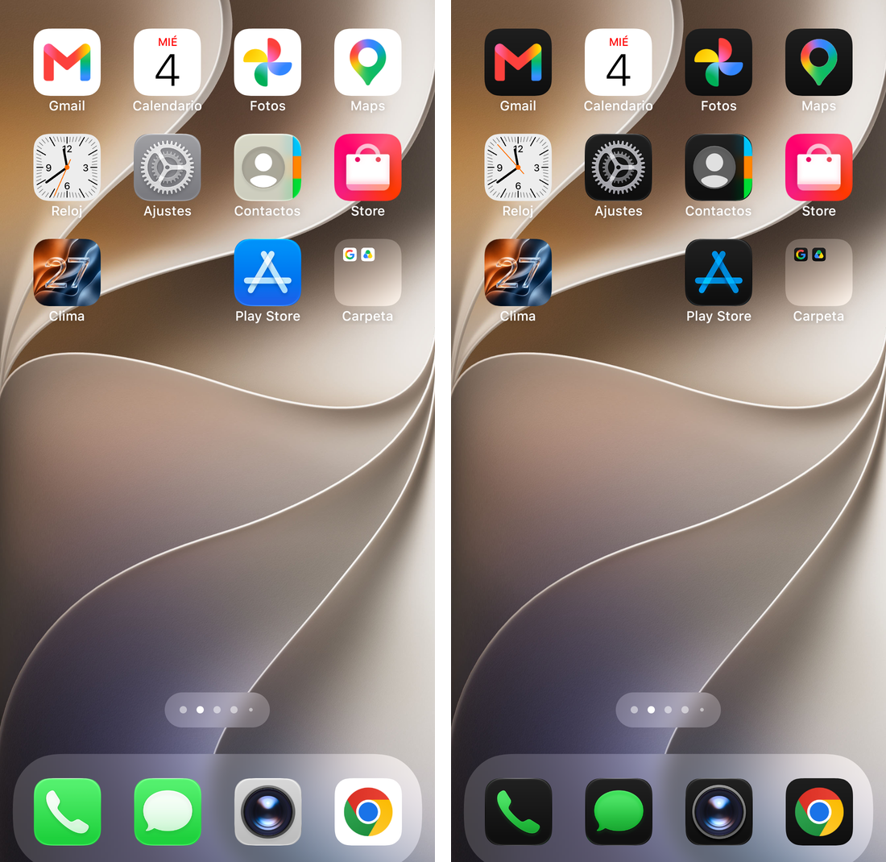
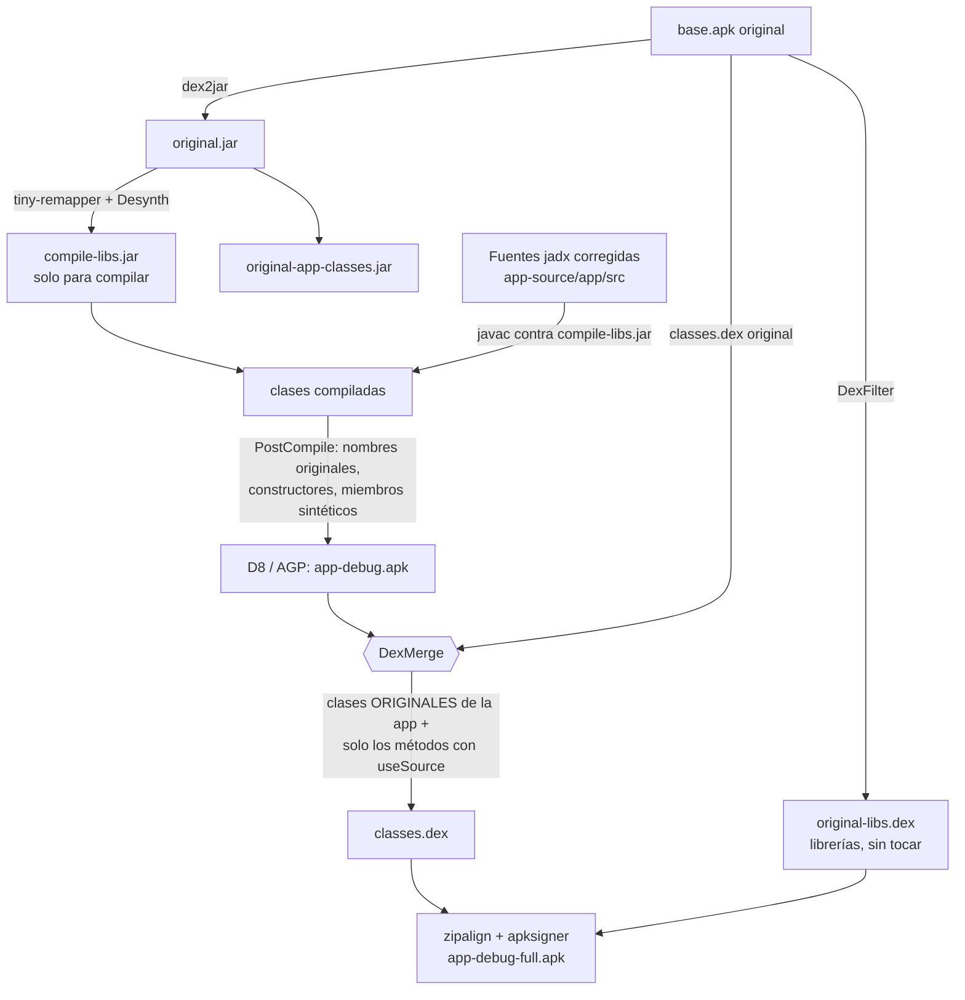

# iOS Launcher: recompilación desde código decompilado

Copia **recompilable** de un launcher de Android con estilo iOS (`com.luutinhit.launcherios`, v8.9.2),
hecha para uso personal: se parte del APK de Play Store, se decompila, se corrige el código hasta que
compila y se vuelve a empaquetar con cambios propios (idioma, íconos iOS 27 en claro y oscuro, sin el
cartel de calificación).

<p align="center">
  
  <br><em>Primera página y dock en modo claro (izquierda) y oscuro (derecha). Los íconos cambian solos con el tema del sistema.</em>
</p>

> **Aviso.** Este repo contiene código decompilado de una app de terceros. No tiene relación con su
> autor ni con Apple. No incluye el APK ni las claves de API del original; esas piezas se obtienen de
> tu propia copia de la app. Es un repo **privado** de uso personal; antes de hacerlo público hay que
> resolver el tema de derechos (ver [Aviso legal](#aviso-legal)).

## Contenido

1. [Qué cambia respecto al original](#qué-cambia-respecto-al-original)
2. [Cómo funciona](#cómo-funciona)
3. [Estructura del repo](#estructura-del-repo)
4. [Requisitos](#requisitos)
5. [Compilar](#compilar)
6. [Instalar y usar](#instalar-y-usar)
7. [Cambiar el comportamiento de la app](#cambiar-el-comportamiento-de-la-app)
8. [Íconos en claro y oscuro](#íconos-en-claro-y-oscuro)
9. [Herramientas](#herramientas)
10. [Depuración en el teléfono](#depuración-en-el-teléfono)
11. [Estado y problemas conocidos](#estado-y-problemas-conocidos)
12. [Documentos](#documentos)
13. [Aviso legal](#aviso-legal)

## Qué cambia respecto al original

| Cambio | Detalle |
|---|---|
| Recompilado desde código | El código Java sale de jadx, corregido a mano y con scripts hasta que compila. |
| Se ejecuta el código original | El APK final no usa el código decompilado salvo en los métodos que se modificaron a propósito (ver [Cómo funciona](#cómo-funciona)). |
| Español | Se importaron las cadenas de `split_config.es.apk` (`values-es`, `values-es-rUS`, `values-b+es+419`). |
| Íconos iOS 27 en claro y oscuro | 56 íconos con versión clara (`drawable/`) y oscura (`drawable-night/`): 25 de Apple (kit oficial para Figma), 16 de apps instaladas en el teléfono y 15 derivados del original. |
| Cambio automático de tema | `ThemeIconReloader` vacía la caché de íconos y recarga la pantalla cuando el sistema pasa de claro a oscuro, también si el cambio ocurrió con el launcher cerrado. |
| Sin cartel de calificación | `IOSLauncher.startRatingActivity()` está vacío: el pedido de "5 estrellas" no aparece solo. Los botones de calificar de los ajustes siguen funcionando. |
| Sin enlaces a Play Store | Se ocultan en los ajustes la tarjeta de "Clasificación 5 estrellas / Descarga otras aplicaciones" y la de las otras apps del desarrollador (Lock Screen, Control Center, AssistiveTouch); en la pantalla principal de la app, compartir (comparte un enlace de Play Store), calificar y el botón flotante de la estrella; y en la búsqueda, "Buscar en la tienda". En el manifest se desactiva `RatingActivity` y se quitan las marcas de distribución de Play. Es solo de recursos (`tools/scripts/remove_play_store_links.py`). No se tocó el acceso directo a la app Play Store de la pantalla de inicio. |
| Ajustes sin cabecera | En la pantalla de ajustes de la app se quitan la imagen "LAUNCHER IOS" de arriba y el botón de correo; (`tools/scripts/hide_settings_header.py`). La imagen no se oculta con `gone` sino que queda invisible, de 1dp y sin imagen: el rebote del scroll divide por su altura y con altura 0 la app se cerraba al hacer scroll. |
| Sin menú lateral | Se quita el menú que se deslizaba desde la izquierda de los ajustes y su botón; la lista empieza arriba. "Política de privacidad", "Cómo utilizar" y "Acerca de" eran páginas web del desarrollador y pasan al repositorio, reescritas, en [`docs/`](docs/); "Sitio web" se elimina sin reemplazo; "Lanzador de recarga" es ahora la última fila de la lista de ajustes. El `DrawerLayout` y el `NavigationView` siguen en el layout (el código original los busca) pero ocultos y bloqueados (`tools/scripts/remove_drawer_menu.py`). |
| Primera carga sin "Play Auto Installs" | `LauncherProvider.loadDefaultFavoritesIfNecessary()` ignora el layout de Samsung que dejaba íconos sin posición. |

Cada cambio de comportamiento está registrado en [`app-source/docs/RECOMPILE-NOTES.md`](app-source/docs/RECOMPILE-NOTES.md).

## Cómo funciona

El problema de fondo: el decompilador no recupera todo bien. En esta app aparecieron bucles infinitos
(`break` perdidos), `synchronized` mal ubicado (un bloqueo mutuo al arrancar), código duplicado, ramas
perdidas y clases `enum` rotas. Además, dex2jar convierte `new X; <init> del ancestro` en `new Ancestro`
cuando R8 había quitado el constructor intermedio, así que ni siquiera el bytecode de dex2jar sirve para
ejecutarse. La solución fue **dejar de ejecutar el código decompilado** y usarlo solo para compilar y
para los cambios propios.



1. **`tools/libjar`** prepara lo que necesita el proyecto a partir de tu APK:
   - `compile-libs.jar`: el bytecode original con los nombres de jadx y los constructores que R8 quitó,
     solo para que `javac` compile.
   - `original-libs.dex`: el `classes.dex` original sin las clases de la app que se compilan desde fuente.
     Se incluye sin modificar.
   - `original-app-classes.jar`: las clases de la app, para recuperar miembros sintéticos.
2. **`PostCompile`** (transformación de AGP) devuelve los nombres originales ofuscados y corrige llamadas a
   constructores que solo existen para compilar.
3. **`DexMerge`** arma el dex de la app con las **clases originales** y reemplaza únicamente los métodos
   cuyo código fuente llama a `JadxSupport.useSource()`, más lo que esos métodos necesiten de lo compilado.
4. Los recursos usan IDs estables (`app/stable-ids.txt`, sacado del `public.xml` de jadx más los recursos de
   los splits), porque el bytecode de las librerías tiene IDs de recursos escritos a mano.

## Estructura del repo

```
app-source/                 Proyecto Gradle de la app (AGP 9.0.1, Gradle 9.3.0)
  app/build.gradle          Compilación, PostCompile, DexMerge, firma y alineado
  app/stable-ids.txt        IDs de recursos fijos
  app/compiled-extra-classes.txt  Clases nuevas que solo usan los layouts (DexMerge las incluye)
  app/libs/                 mapping.tiny y added-ctors.txt (los .jar/.dex se generan, ver Compilar)
  app/src/main/java/        Código jadx corregido + JadxSupport + ThemeIconReloader
  app/src/main/res/         Recursos (incluye drawable/ y drawable-night/ con los íconos)
  docs/RECOMPILE-NOTES.md   Registro de cambios de comportamiento
tools/
  libjar/                   Prepara librerías y herramientas: DexFilter, Desynth, CtorGen, PostCompile, DexMerge
  scripts/                  Scripts de Python que corrigen el código decompilado y generan íconos
  icondump/IconDump.java    Extrae los íconos reales de las apps instaladas en el teléfono
docs/                       Política de privacidad, guía de uso y "Acerca de" (antes eran páginas web dentro de la app) e imágenes
mappings/                   Nombres puestos a mano (manual.tsv) y el mapa de jadx del que salen
app-source-lib-java/        Solo jadx-generated/public.xml
docs/images/                Imágenes del README
```

## Requisitos

- Windows, macOS o Linux. El proyecto se desarrolló en Windows 11.
- **JDK 21** (se usó Eclipse Temurin 21).
- **Android SDK** con la plataforma `android-36.1` y `build-tools;36.1.0`.
- **Python 3** con `Pillow` (solo para los scripts de íconos).
- **adb** y un teléfono arm64 con depuración USB para instalar y probar.
- Tu propia copia del APK de `com.luutinhit.launcherios` v8.9.2 (versionCode 892), con sus splits.
- Opcional: [jadx](https://github.com/skylot/jadx) 1.5.6, solo si vas a volver a decompilar.

Las librerías de Gradle (dex2jar `de.femtopedia.dex2jar:dex-tools:2.4.38`, tiny-remapper 0.15.0,
ASM 9.8, smali-dexlib2 3.0.10) se bajan solas.

## Compilar

### 1. Conseguir el APK original

Con la app instalada en un teléfono:

```bash
mkdir original-apk
adb shell pm path com.luutinhit.launcherios       # lista base.apk y los splits
adb pull <ruta>/base.apk original-apk/base.apk
# repetí con split_config.xxhdpi.apk, split_config.arm64_v8a.apk y split_config.es.apk
```

`original-apk/` está en `.gitignore`: no lo subas.

### 2. Clave de API (opcional)

El `AndroidManifest.xml` del repo tiene el marcador `REPLACE_WITH_THE_KEY_FROM_YOUR_ORIGINAL_APK` en lugar de
la clave de Google del autor original. Para restaurarla desde tu APK:

```bash
python -I tools/scripts/restore_api_key.py original-apk/base.apk app-source/app/src/main/AndroidManifest.xml
```

No hagas commit del manifest después de esto.

### 3. Generar librerías y herramientas

Desde la raíz del repo, con `JAVA_HOME` apuntando al JDK 21:

```bash
mkdir -p tools/libjar/build/work
cp app-source/app/libs/mapping.tiny tools/libjar/build/work/
cd tools/libjar
../../app-source/gradlew libsJar appClassesJar libDex installTool
cd ../..
```

Esto crea `app-source/app/libs/compile-libs.jar`, `original-libs.dex`, `original-app-classes.jar` y
`app-source/tools-bin/` (PostCompile y DexMerge con sus dependencias).

### 4. Compilar la app

Creá `app-source/local.properties` con la ruta del SDK (o definí `ANDROID_HOME`):

```properties
sdk.dir=/ruta/al/Android/Sdk
```

```bash
cd app-source
./gradlew assembleDebugFull
```

El resultado es `app-source/app/build/outputs/apk/debug/app-debug-full.apk`: el dex de la app más
`original-libs.dex` como `classes2.dex`, alineado y firmado con la clave de debug (`~/.android/debug.keystore`).

La salida de DexMerge no aparece en el log de Gradle. Para ver qué métodos tomó y si hay avisos:

```bash
java -cp "app-source/tools-bin/*" DexMerge original-apk/base.apk \
  app-source/app/libs/original-libs.dex app-source/app/build/outputs/apk/debug/app-debug.apk salida.dex \
  app-source/app/compiled-extra-classes.txt
```

## Instalar y usar

```bash
adb install -r --no-incremental app-source/app/build/outputs/apk/debug/app-debug-full.apk
```

- Si tenés instalado el original, la firma no coincide: hay que **desinstalarlo antes** (se pierde su configuración).
- Después elegí la app como launcher por defecto en los ajustes de Android.
- `--no-incremental` evita que un `.idsig` viejo haga fallar la firma.

## Cambiar el comportamiento de la app

Editá el método en `app-source/app/src/main/java/...` y poné como **primera línea**:

```java
com.luutinhit.launcher6.JadxSupport.useSource();
```

Sin esa marca el cambio se compila pero **no llega al APK**, porque se ejecuta el método original. Casos conocidos:

- **Constructores:** no pueden llevar la marca.
- **Un cambio que parece ignorado:** D8 a veces mueve el cuerpo a un método sintético `$invoke$special$<nombre>` y deja
  `<nombre>` como reenvío. `DexMerge` lo detecta y reemplaza el método original por el reenvío. Así se resolvió que el
  cartel de calificación volviera a aparecer.
- Métodos que contienen `new java/lang/Object` mal tipado por dex2jar (`A2.run`, `W1.onCreate`) siguen usando la fuente.

Métodos con `useSource` hoy: `LauncherProvider.loadDefaultFavoritesIfNecessary()`, `IOSLauncher.startRatingActivity()`,
`LauncherAppState.getInstance()` y `MainActivity.reloadLauncher(View)` (un método nuevo, que el layout llama con
`android:onClick`).

**Clases nuevas que solo usa un layout** (por ejemplo `LockedDrawerLayout`): `DexMerge` solo incluye una clase nueva si algún
método marcado la alcanza, así que estas se anotan a mano en `app-source/app/compiled-extra-classes.txt`.

## Íconos en claro y oscuro

Los íconos por app están en `res/drawable/` (claro) y `res/drawable-night/` (oscuro). Android elige según el tema del sistema
y `ThemeIconReloader` recarga la caché de íconos al cambiar.

- **Apple (25):** vienen del kit oficial *iOS and iPadOS 27* para Figma (componente `_System Icons`, variantes `Default` y `Dark`),
  exportado a 8x en PNG. Ese kit no está en el repo.
- **Apps de terceros (16):** `tools/icondump` pide a Android el ícono real de cada app instalada y guarda también la capa
  frontal del ícono adaptativo. La versión oscura es esa capa sobre el degradé oscuro de Apple; si el dibujo es blanco sobre
  un fondo de color, toma ese color.
- **Resto (15):** la versión oscura se deriva de la imagen original (se detecta el fondo, se oscurece y se conserva el dibujo).

Para regenerarlos:

```bash
# 1. íconos de las apps instaladas (el teléfono debe estar conectado)
javac --release 17 -cp "$ANDROID_HOME/platforms/android-36.1/android.jar" -d build tools/icondump/IconDump.java
"$ANDROID_HOME/build-tools/36.1.0/d8" --min-api 26 --output build build/IconDump.class
adb push build/classes.dex /data/local/tmp/icondump.dex
adb shell app_process -cp /data/local/tmp/icondump.dex /data/local/tmp IconDump /data/local/tmp/icons com.android.chrome com.whatsapp ...
# 2. exportar el kit de Figma a una carpeta y correr el generador
python -I tools/scripts/build_theme_icons.py <carpeta-figma> <carpeta-íconos-del-teléfono> app-source/app/src/main/res <carpeta-respaldo>
```

## Herramientas

| Script | Para qué |
|---|---|
| `build_jobf.py` | Une los nombres de `mappings/manual.tsv` con el mapa automático de jadx. |
| `jobf_to_tiny.py` | Convierte el mapa de jadx a formato Tiny v1 para tiny-remapper. |
| `relax_modifiers.py` | `private` → `public` y quita `final` donde el dex permitía lo que `javac` rechaza. |
| `fix_from_log.py`, `list_errors.py`, `summarize_log.py` | Corrigen o resumen errores de `javac` a partir del log de Gradle, línea por línea. |
| `fix_ctors.py`, `restore_enums.py`, `fix_jadx_throwables.py` | Restauran constructores, enums y `throws` que jadx no pudo reconstruir. |
| `fix_raw_res_ids.py`, `fix_style_enums.py`, `import_density_split.py` | Arreglan recursos: IDs sin nombre, estilos y los dibujables que solo están en el split de densidad. |
| `find_infinite_loops.py`, `mark_original_bytecode.py` | Detectan bucles infinitos y métodos que jadx marcó como dudosos. |
| `build_theme_icons.py`, `tools/icondump` | Íconos claro/oscuro (ver arriba). |
| `restore_api_key.py` | Restaura la clave de API del manifest desde tu APK. |
| `remove_drawer_menu.py` | Quita el menú lateral de los ajustes y agrega "Lanzador de recarga" a la lista (layouts y un ícono). |
| `hide_settings_header.py` | Oculta la imagen de cabecera y el botón de correo de los ajustes de la app (solo layout). |
| `remove_play_store_links.py` | Oculta o quita lo que apunta a Play Store (recursos y manifest). Conserva los saltos de línea de cada archivo y se puede repetir sin efecto. |
| `match_*.py`, `class_digest.py`, `method_summary.py` | Ayudas para ponerle nombres a mano al código ofuscado. |

Un consejo aprendido: escribí los parches de Python con un archivo en vez de pasarlos por la línea de comandos; las
barras invertidas se corrompen fácilmente.

## Depuración en el teléfono

```bash
adb logcat -d | grep -E "FATAL|AndroidRuntime|VerifyError"
adb shell run-as com.luutinhit.launcherios ls databases            # la compilación es depurable
adb forward tcp:8700 jdwp:<PID> && jdb -attach localhost:8700      # "where all" muestra qué hilo está colgado
adb exec-out run-as com.luutinhit.launcherios cat databases/launcher.db > launcher.db   # exec-out no altera los bytes
```

- En Git Bash, `MSYS_NO_PATHCONV=1` evita que cambie las rutas del teléfono, pero entonces `JAVA_HOME` debe ser una
  ruta de Windows o `apksigner.bat` falla.
- Si cambiaste los íconos y no se ven, borrá `databases/app_icons.db` con la app detenida: la caché guarda los bitmaps viejos.
- Android reinicia solo el launcher por defecto al detenerlo. Si vas a editar su base de datos, detené la app y reemplazá el
  archivo en el mismo comando.

## Estado y problemas conocidos

- Funciona en un teléfono Samsung arm64: pantalla de inicio con dock, App Library, vista Hoy, widgets, español.
- **Solo `arm64-v8a`** (las librerías nativas vienen del split arm64 del original).
- Compilación firmada con la clave de debug.
- El cambio automático de tema se verificó en el teléfono en las dos direcciones (claro → oscuro y oscuro → claro).
  El launcher da cada ícono iOS a **una sola app** (`IconCache.m8023y`); por eso `ThemeIconReloader` también vacía ese
  mapa al recargar, y por eso dos apps del mismo tipo no comparten el mismo ícono iOS.
- **Reloj y Calendario no cambian con el tema:** el launcher los dibuja por código (cara blanca, fecha y hora en vivo) y no
  usa los íconos de `drawable/`. **Pendiente.**
- Apps repetidas (por ejemplo, el calendario de Samsung y el de Google muestran el mismo ícono): quitarlas de la pantalla
  de inicio borrando filas de `launcher.db` no sirve, porque el launcher vuelve a agregar a la última página las apps que no
  están en ninguna. La vía correcta es la función de apps ocultas del launcher. **Pendiente.**
- Los íconos de Apple y de marcas de terceros están en `res/` (necesarios para compilar). Son de sus dueños.

## Documentos

Lo que antes eran páginas web abiertas desde el menú lateral de la app ahora vive aquí, reescrito:

- [`docs/PRIVACY.md`](docs/PRIVACY.md): política de privacidad de esta copia (qué datos usa, qué sale del teléfono y qué puedes controlar).
- [`docs/HOW-TO-USE.md`](docs/HOW-TO-USE.md): guía de uso (reemplaza el video de ayuda).
- [`docs/ABOUT.md`](docs/ABOUT.md): qué es esta copia, qué cambia y los créditos.

## Aviso legal

- El código de `app-source/app/src` es la salida de un decompilador sobre una app de terceros, con correcciones. Los derechos
  son de su autor. El repo es privado y para uso personal e interoperabilidad; **no lo publiques ni lo redistribuyas** sin
  resolver ese tema.
- No incluye el APK original, claves, datos del teléfono ni capturas con información personal.
- Los íconos de apps de Apple provienen de recursos que Apple publica para diseñadores; los de apps de terceros son sus
  logotipos. Se usan solo en esta copia personal.
- "iOS", "iPhone" y los nombres de las apps de Apple son marcas de Apple Inc. Este proyecto no está afiliado a Apple.
